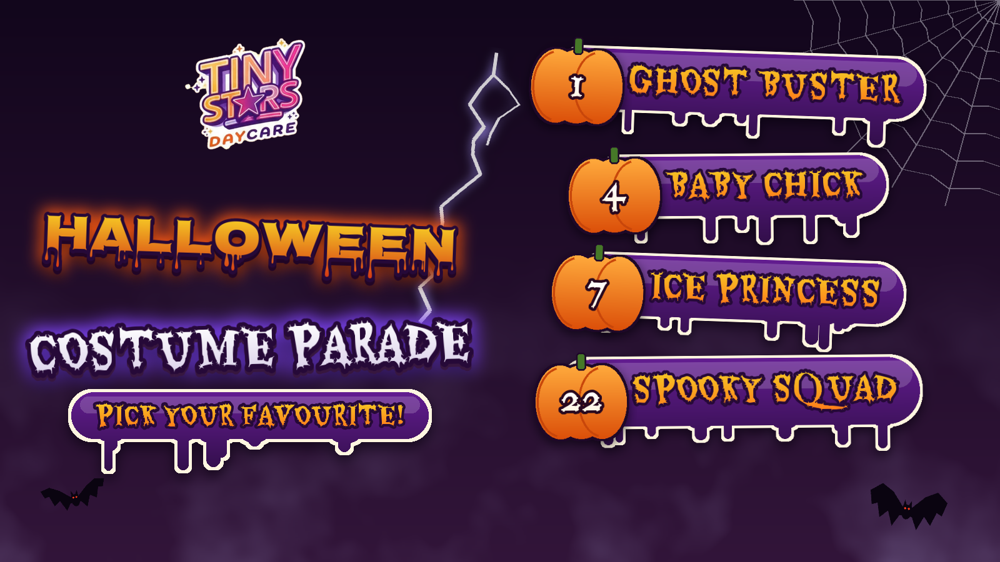

# Tiny Stars Halloween Costume Parade reel

Code that turns a folder of Halloween photo-booth pictures from [Tiny Stars Daycare](https://tinystars.ca) (Grande Prairie, Alberta) into a 24-second horror-themed vertical reel for Instagram, Facebook and TikTok, plus a matching carousel and collage post. **Every face is blurred**, kids and parents alike, and every cut lands on the beat of the music.



*The graphics on their own. The finished reel puts these over the costume photos.*

## What it makes

- **The reel** (1080×1920 full HD, 30 fps, H.264 + AAC, normalised to −14 LUFS, 24 seconds):
  - a **cold open**: thunder and lightning over an animated haunted-house scene, with "Something spooky happened at..." flickering in before the logo
  - a **title slam** on the first beat: "Halloween" in neon-glow gothic lettering, COSTUME PARADE in tracked capitals
  - the **12 best costumes**, each on a frosted-glass name tag with a neon number, joined by **horror transitions**: lightning strike, RGB glitch, failing-light flicker, ghost after-image, zoom punch and fog, each with its own sound effect
  - a numbered **vote grid** with a glowing frame that hops between costumes
  - an animated **"Thanks for Watching"** outro in a haunted classroom: neon lettering on a lightning strike, glass contact cards that glitch in, drifting embers, fog and bats
- **A no-music version** (same picture, sound effects only), for adding a trending sound inside the app.
- **A phone copy**: the same full-HD reel as a two-pass encode under 30 MiB, small enough to send to a phone.
- **A 10-slide 4:5 carousel**, a numbered collage of the 12 costumes, and a reel cover.

## Privacy first

The photos, the face boxes and everything rendered from them stay out of git (see `.gitignore`). Faces are handled in three steps:

1. `detect_faces.py` runs OpenCV's YuNet detector at two scales. Confident hits are kept automatically.
2. Weaker hits, and anything the detector missed, are checked by eye on review sheets. Fixes go in `edits/face_fixes.json`.
3. `blur_faces.py` pixelates each face, then heavily blurs it inside a padded, feathered ellipse that also covers the hairline and chin. It works on the full-resolution originals.

## Run it

You need Python 3.12, [uv](https://docs.astral.sh/uv/) and `ffmpeg` on your PATH. None of the media is in the repo. Put these back first:

- `source/drive_raw/`: the HEIC/JPG photos
- `source/music/ghosts_of_the_past_171666.mp3` and `source/sfx/*.mp3`: thunder, impact, whoosh, ghost_whoosh, glitch, riser, witch, hit (all from Pixabay)
- `source/brand_ref/tinystars_thanks_for_watching.png`: the daycare's Halloween end card, which the high-resolution logo is cut from
- `source/opengen/`: `intro_scene.mp4`, `intro_night_scene.jpg`, `outro_haunted.mp4` and `outro_haunted_bg.jpg`, generated with OpenGen (Nano Banana 2.1 for the stills, Veo 3.1 Lite for the clips)

```bash
uv venv --python 3.12 .venv
uv pip install --python .venv/Scripts/python.exe -r requirements.txt
.venv/Scripts/python.exe -I tools/fetch_assets.py     # fonts, face model, logo
.venv/Scripts/python.exe -I edits/prep_photos.py      # HEIC -> upright JPGs + contact sheets
.venv/Scripts/python.exe -I edits/detect_faces.py     # face boxes -> work/faces.json, review images
.venv/Scripts/python.exe -I edits/review_faces.py     # 2x2 sheets for checking faces by eye
.venv/Scripts/python.exe -I edits/blur_faces.py       # full-resolution blurred photos
.venv/Scripts/python.exe -I edits/cut_stickers.py     # high-resolution logo from the end card
.venv/Scripts/python.exe -I edits/stills.py           # layout check frames
.venv/Scripts/python.exe -I edits/render.py           # the reel, with music and without
.venv/Scripts/python.exe -I edits/posts.py            # carousel, collage, reel cover
```

The photo order, the costume labels, each cut's transition, the timing (in beats) and the outro text all live in `edits/content.py`.

`render.py` writes every frame to `work/frames.rgb` before encoding, so it needs about 5 GB of free disk but little memory. If it stops (for example when the PC runs short of memory), run it again and it carries on from the last finished frame.

## Tech stack

- **Python** with NumPy, OpenCV (YuNet face detection, warping, compositing) and Pillow (lettering and graphics, `pillow-heif` for iPhone photos)
- **FFmpeg** for H.264/AAC encoding and two-pass EBU R128 loudness normalisation
- **Fonts:** Grenze Gotisch (neon gothic titles), Cinzel (costume names) and Montserrat (small print), all from Google Fonts (OFL)
- **Music and sound effects:** "Ghosts of the Past" by melodyayresgriffiths on [Pixabay](https://pixabay.com/music/scary-childrens-tunes-ghosts-of-the-past-instrumental-halloween-autumn-spooky-upbeat-boppy-171666/), plus Pixabay sound effects (Pixabay Content License, no Content ID)
- **AI backgrounds:** [OpenGen](https://opengen.ai) (Nano Banana 2.1 stills, Veo 3.1 Lite image-to-video) for the haunted house and the haunted classroom. No child appears in any generated footage.

## License

The code is MIT licensed (see `LICENSE`). The Tiny Stars name and logo belong to Tiny Stars Daycare. The fonts, the face model and the music keep their own licenses.
